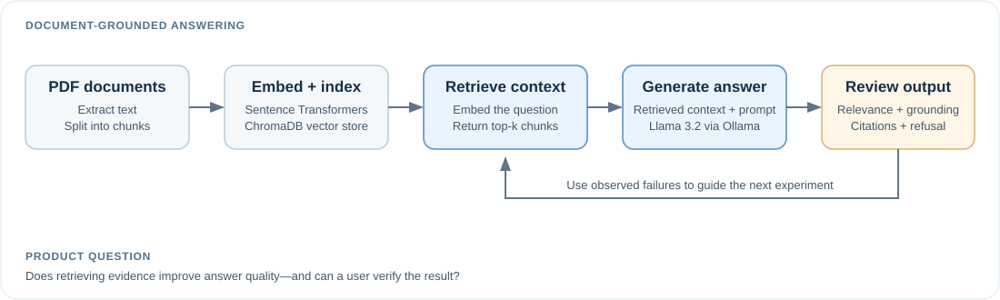

# Product Copilot — Product Story

> **A learning prototype for Product Management interview prep:** ask questions about a focused collection of PDFs and explore whether retrieval makes AI answers more relevant, grounded, and traceable.

## The product at a glance

| | Summary |
|---|---|
| **User** | Someone preparing for Product Management interviews with their own study documents |
| **Problem** | A general-purpose LLM may give a plausible answer without showing whether it is supported by the supplied material |
| **Product idea** | Retrieve relevant passages from a defined document collection before generating an answer |
| **What I wanted to learn** | How ingestion, embeddings, retrieval, generation, citations, and refusal behaviour fit together—and where the workflow breaks down |
| **Status** | Exploratory prototype, not a production-ready product |

## The user journey

1. **Ask:** the user asks a Product Management interview question.
2. **Retrieve:** the system searches chunks created from the supplied PDFs.
3. **Generate:** the retrieved context is passed to Llama 3.2 through Ollama to draft an answer.
4. **Inspect:** the answer and its citations can be reviewed for relevance, grounding, and appropriate refusal when the documents do not support an answer.

## The product hypothesis

**Hypothesis:** giving the model relevant passages from a defined document collection can make answers more grounded than relying on general model knowledge alone.

The important caveat is that retrieval does not guarantee correctness. A retrieved passage may be incomplete or poorly matched, and the model may still overstate what the evidence says.

## Key product and experiment decisions

| Decision | Why it mattered |
|---|---|
| Use a focused collection of PDFs | Defines the knowledge boundary for the interview-prep use case |
| Build a retrieval-augmented generation (RAG) flow | Makes document retrieval part of answer generation rather than relying only on the model's general knowledge |
| Explore retrieving 5 versus 10 chunks | Investigates how the amount of retrieved context may affect answer quality |
| Review citations, grounding, and refusal behaviour | Looks beyond “did it produce an answer?” to whether the answer is supported and appropriate |
| Use a local LLM through Ollama | Made it possible to experiment with Llama 3.2 in the prototype |

## What I built

- **Interface:** Streamlit
- **Pipeline:** Python-based document ingestion, retrieval, answer generation, and evaluation workflow
- **Vector store:** ChromaDB
- **Embeddings:** Sentence Transformers
- **Generation:** Llama 3.2 through Ollama

I used Cursor AI as a development assistant. My focus was on framing the use case, understanding the end-to-end workflow, making product and experiment decisions, testing the prototype, and interpreting its limitations.

## What testing revealed

In one exploratory run of 14 questions, manual review found several distinct failure patterns:

- **Grounding:** 2 of 8 questions initially labelled answerable received a full grounding pass; 5 were partial and 1 failed.
- **Citations:** 4 of 7 answerable questions that received an answer had passing citation quality; placeholder citations and incomplete filenames remained problems.
- **Refusal behaviour:** 4 of 6 questions initially labelled unanswerable were cleanly refused. One answerable metrics question was refused, and another unanswerable case gave a long answer before saying the information was not covered.
- **Evaluation hygiene:** one expected-answerability label appears incorrect because the source corpus contains project-manager responsibilities.

These are small-sample, manually scored results, not a general model-accuracy benchmark. The current export does not record whether a run used 5 or 10 retrieved chunks, so it cannot support a comparison between those settings. See the [evaluation report](evaluation.md) and [scored question-level results](../evaluation/results-scored.csv).

## What I would improve next

1. **Make evidence easier to verify:** ensure cited passages directly support the associated claims.
2. **Test answerable and unanswerable questions separately:** distinguish a justified refusal from an unnecessary one.
3. **Compare retrieval settings systematically:** score the same test questions with 5 and 10 retrieved chunks, then compare each evaluation dimension.
4. **Track failures by category:** avoid relying on one average that could hide a weak area.

## Project materials

- [Project presentation and demo link](https://docs.google.com/presentation/d/1QjBAjTKasTCv3R4ATYLV3Gpx4suKrDiSL4ZI6n-rwGQ/edit?slide=id.p1#slide=id.p1)
- [Evaluation approach and observed findings](evaluation.md)
- [Evaluation case template](../evaluation/evaluation-cases-template.csv)

---

**Takeaway:** this project was not just about making a chatbot answer questions. It was about exploring the product decisions behind a document-grounded AI workflow—and using failure cases to understand what would need to improve before anyone could rely on it.
